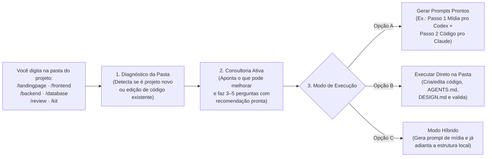

# Agent Project Kit

Um kit de **skills, comandos interativos (`/`) e playbooks de engenharia** para orientar agentes de desenvolvimento (**Claude Code**, **Antigravity**, **Codex**) na criação, edição, redesign e revisão de projetos reais — do diagnóstico da pasta à validação em navegador e deploy.

[Instalação Rápida (1 min)](#-instalação-rápida-1-minuto) · [Como Funciona](#-como-funciona-na-prática) · [Comandos (`/`)](#-comandos-dinâmicos-criar-editar-e-ajustar) · [Casos de Uso Reais](#-casos-de-uso-reais) · [Mapa do Kit](#-mapa-de-skills-e-referências) · [Guia Completo](GUIA_SKILLS_DESENVOLVIMENTO.md)

---

## ⚡ Instalação Rápida (1 minuto)

### 1. Clonar e registrar os comandos (`/`) e skills globais

Abra o terminal na pasta onde guarda suas ferramentas (ex.: `F:\Skills`, `C:\Skills` ou `~/Skills`) e execute:

**Windows (PowerShell):**
```powershell
git clone https://github.com/LucasCamy/agent-project-kit.git
cd agent-project-kit
powershell -ExecutionPolicy Bypass -File ./scripts/install-commands.ps1
```

**Linux / macOS (Bash):**
```bash
git clone https://github.com/LucasCamy/agent-project-kit.git
cd agent-project-kit
bash ./scripts/install-commands.sh
```

> **O que o instalador configura automaticamente:**
> - **Claude Code (`~/.claude/commands/`):** registra os comandos `/landingpage` (`/create-landing`), `/frontend`, `/backend`, `/database`, `/review` e `/kit` apontando para o seu clone local.
> - **Antigravity (`~/.gemini/config/skills/`):** sincroniza todas as skills globalmente para que fiquem disponíveis em qualquer projeto aberto.
> - **Para atualizar depois:** rode `git pull --ff-only` dentro da pasta do kit e execute novamente o script `install-commands`.

### 2. (Opcional) Skills complementares de UI & Motion para Front-end

Ao trabalhar em criação ou redesign de telas e landing pages, você pode adicionar no projeto os pacotes visuais complementares (detalhados no [catálogo externo](skills/project-workflow/references/catalog.md)):

```bash
npx skills add https://github.com/Leonxlnx/taste-skill
npx skills add https://github.com/nextlevelbuilder/ui-ux-pro-max-skill
npx skills add https://github.com/kylezantos/design-motion-principles
npm install -g ui-ux-pro-max-cli
```

---

## 🧠 Como Funciona na Prática

Em vez de obrigar você a decorar caminhos de arquivos ou escrever especificações gigantes do zero, o kit opera por meio do **[Consultor Interativo](skills/interactive-consultant/SKILL.md)** combinado ao **[Fluxo de Projeto](skills/project-workflow/SKILL.md)**:



---

## 🛠️ Comandos Dinâmicos (Criar, Editar e Ajustar)

Todos os comandos funcionam tanto para **criar um projeto do zero** quanto para **editar, ajustar, refatorar ou corrigir um projeto existente**. Veja detalhes em **[commands/README.md](commands/README.md)**.

| Comando | Para que serve | Principais referências acionadas |
|---|---|---|
| **`/landingpage`** *(ou `/create-landing`)* | **Criar** landing pages de alta conversão (`ARQ-A` Corporativo/Noturno, `ARQ-B` Arquitetura/Editorial, `ARQ-C` Produto/SaaS, `ARQ-D` Catálogo + Sacola no WhatsApp), **editar seções**, **trocar mídias AVIF+WebP** ou **gerar os 2 prompts prontos** (Mídia + Código). | [Pipeline de Mídia](skills/frontend-figma-playwright/pipeline-midia/README.md) · [Catálogo `ARQ-A..D`](skills/frontend-figma-playwright/pipeline-midia/01-catalogo-formas-e-animacoes.md) · [Scroll Motion](skills/frontend-figma-playwright/references/scroll-motion.md) · [Landing Page](skills/frontend-figma-playwright/references/landing-page.md) |
| **`/frontend`** | **Criar, redesenhar ou ajustar telas de sistemas, painéis e apps** com direção criativa (*Creative North Star*), `tokens.css` (claro/escuro sem cores default do Tailwind), contraste AA calculado, `Estado = Forma + Texto + Cor`, recomposição mobile e validação Playwright. | [Sistema Visual de Produto](skills/frontend-figma-playwright/references/product-ui-system.md) · [Front-end Figma/Playwright](skills/frontend-figma-playwright/SKILL.md) · [Anatomy](skills/frontend-figma-playwright/references/anatomy.md) |
| **`/backend`** | **Criar, editar ou otimizar APIs, regras de negócio e integrações** preservando a arquitetura existente, alinhando DTOs, `ProblemDetails`, autorização, idempotência e concorrência antes de codar. | [Back-end .NET](skills/backend-dotnet/SKILL.md) · [Docker, Deploy & Webhooks](skills/project-workflow/references/docker-deploy.md) |
| **`/database`** | **Criar, ajustar ou otimizar schema, queries, índices e migrations** avaliando isolamento, condições de corrida, prevenção de `N+1` e separando gerar migration, revisar SQL e aplicar. | [Persistência e Banco](skills/database-persistence/SKILL.md) |
| **`/review`** | **Auditar um projeto existente** (UX/overflow em 7 larguras com Playwright, conformidade legal LGPD no Brasil, segurança, performance de mídia `.avif`/`?v=<hash>` e documentação/ADRs). | [Matriz de Validação](skills/project-workflow/references/validation.md) · [Conformidade Legal (LGPD)](skills/project-workflow/references/conformidade-legal.md) · [Security Audit](skills/project-workflow/references/security-audit.md) |
| **`/kit`** | **Atalho universal:** inspeciona qualquer repositório, explica o que encontrou, sugere melhorias priorizadas e carrega apenas os módulos necessários. | [Consultor Interativo](skills/interactive-consultant/SKILL.md) · [Fluxo de Projeto](skills/project-workflow/SKILL.md) |

---

## 🚀 Casos de Uso Reais

### Caso 1: Landing Page com Scrollytelling ou Catálogo + Sacola no WhatsApp (`/landingpage`)

Ideal para criar páginas institucionais cinematográficas (`GSAP + ScrollTrigger + Lenis`) ou lojas-boutique onde o cliente monta a sacola (com tamanho, cor e cálculo de frete grátis) e finaliza o pedido formatado no WhatsApp (`https://wa.me/`).

```text
/landingpage criar loja de roupa feminina com catálogo 4:5, filtro de tamanho e sacola que envia o pedido pro WhatsApp
```

```text
/landingpage editar a seção de projetos desta página para usar trilho horizontal escuro e regenerar os quadros AVIF
```

> Quer ir direto aos prompts prontos de **Mídia (AVIF + WebP + Vídeo `xfade` + 120 quadros `<canvas>`)** e **Implementação**? Acesse **[pipeline-midia/README.md](skills/frontend-figma-playwright/pipeline-midia/README.md)**.

---

### Caso 2: Criação ou Redesign de Telas de Sistemas e Apps (`/frontend`)

Aplica a metodologia de **[product-ui-system.md](skills/frontend-figma-playwright/references/product-ui-system.md)** para que sistemas financeiros, CRMs, portais e apps tenham identidade própria (*Creative North Star*) em vez de parecerem templates genéricos:

- **Hierarquia operacional:** a próxima ação vem sempre antes do histórico e das métricas.
- **Tokens estritos (`tokens.css`):** claro e escuro com contraste WCAG AA (`≥ 4,5:1`) calculado em tabela sobre todas as superfícies (`bg`, `surface`, `subtle`, `selected`).
- **Semântica visual:** `Estado = Forma (ícone) + Texto + Cor` (ex.: realizado em traço sólido vs. previsto em traço pontilhado).
- **Ergonomia real:** recomposição no mobile (`< 640px` com barra inferior e listas próprias, inputs `≥ 16px`, toque `≥ 44px`), seleção instantânea sem *flick* e estados `Empty`, `Loading/Skeleton` e `Error inline` obrigatórios.

```text
/frontend redesenhar as telas de lançamentos e painel mensal aplicando tokens claro/escuro e separação visual entre realizado e previsto
```

```text
/frontend ajustar o modal de cadastro para corrigir validação inline, foco por teclado e layout em telas de 360px
```

---

### Caso 3: Evolução de Back-end, Banco de Dados e Deploy (`/backend` e `/database`)

```text
/backend editar o fechamento de pedido para validar estoque por variação, garantir idempotência e retornar ProblemDetails
```

```text
/database otimizar a consulta do relatório mensal que está com N+1 e gerar migration com índice composto para revisão do SQL
```

---

### Caso 4: Uso Manual (Sem instalar comandos `/`)

Se estiver em um ambiente onde não rodou o instalador de comandos, basta apontar para a entrada do kit:

```text
Leia [caminho-do-kit]/skills/interactive-consultant/SKILL.md e [caminho-do-kit]/skills/project-workflow/SKILL.md
e atue no projeto [caminho-do-projeto].

Objetivo: [criar, editar, ajustar ou revisar ...]
```

---

## 🗺️ Mapa de Skills e Referências

### Skills Principais (`skills/`)

| Skill | Papel no Kit |
|---|---|
| **[interactive-consultant](skills/interactive-consultant/SKILL.md)** | Diagnóstico consultivo, sugestões proativas, perguntas enxutas e [moldes de geração de prompts](skills/interactive-consultant/references/prompt-templates.md) + [playbooks](skills/interactive-consultant/references/playbooks.md) |
| **[project-workflow](skills/project-workflow/SKILL.md)** | Ponto de entrada técnico: inspeção, seleção enxuta de módulos e integração final |
| **[project-agent-md](skills/project-agent-md/SKILL.md)** | Criação e manutenção cirúrgica do `AGENTS.md` de cada aplicação |
| **[frontend-figma-playwright](skills/frontend-figma-playwright/SKILL.md)** | Fluxo de UI (Figma MCP / `DESIGN.md` / `/styleguide.html`), implementação e conferência visual com Playwright |
| **[backend-dotnet](skills/backend-dotnet/SKILL.md)** | APIs, serviços e regras de negócio C#/.NET preservando contratos e arquitetura real |
| **[database-persistence](skills/database-persistence/SKILL.md)** | Consultas, índices, isolamento, concorrência, schema e ciclo seguro de migrations |
| **[software-documentation](skills/software-documentation/SKILL.md)** | `README.md`, `OpenAPI`, runbooks e [modelo/fluxo de ADRs](skills/software-documentation/references/adr.md) |
| **[agent-coordination](skills/agent-coordination/SKILL.md)** | Divisão de tarefas amplas, roteamento por risco e handoff entre agentes |
| **[skill-discovery](skills/skill-discovery/SKILL.md)** | Descoberta e avaliação crítica de skills externas |

### Guias Técnicos e Pipelines Especializados

- **Front-end & Landing Pages:**
  - [Sistema Visual para Telas, Sistemas e Apps (`product-ui-system.md`)](skills/frontend-figma-playwright/references/product-ui-system.md)
  - [Prompt Especializado de Landing Page (`landing-page.md`)](skills/frontend-figma-playwright/references/landing-page.md)
  - [Animação Ligada ao Scroll — GSAP, ScrollTrigger e Lenis (`scroll-motion.md`)](skills/frontend-figma-playwright/references/scroll-motion.md)
  - [Pipeline Passo a Passo de Mídia AVIF+WebP, Vídeo e Scrollytelling (`pipeline-midia/`)](skills/frontend-figma-playwright/pipeline-midia/README.md)
  - [Ilustrações Isométricas Explicativas (`anatomy.md`)](skills/frontend-figma-playwright/references/anatomy.md)
- **Qualidade, Jurídico, Segurança, Deploy e Gestão:**
  - [Regras Comuns de Execução (`common.md`)](skills/project-workflow/references/common.md)
  - [Matriz de Validação Proporcional (`validation.md`)](skills/project-workflow/references/validation.md)
  - [Docker Multi-Stage, Nginx, Deploy e Integrações/Webhooks (`docker-deploy.md`)](skills/project-workflow/references/docker-deploy.md)
  - [Conformidade Legal antes de Publicar no Brasil — LGPD, Termos e Direitos de Imagem (`conformidade-legal.md`)](skills/project-workflow/references/conformidade-legal.md)
  - [Auditoria de Segurança (`security-audit.md`)](skills/project-workflow/references/security-audit.md)
  - [Gestão e Índice Operacional no Linear (`linear.md`)](skills/project-workflow/references/linear.md)
  - [Catálogo de Skills Externas Conferidas (`catalog.md`)](skills/project-workflow/references/catalog.md)
  - [Guia Completo de Uso e Solução de Problemas (`GUIA_SKILLS_DESENVOLVIMENTO.md`)](GUIA_SKILLS_DESENVOLVIMENTO.md)
